  <picture>
    <source media="(prefers-color-scheme: dark)" srcset="assets/cordillera-oscuro.svg">
    
  </picture>

<h1 align="center">Hola 👋, soy Danilo</h1>

<b>Desarrollador Full Stack</b>

<code>while (vivo) { mate(); codear(); deploy(); }</code>

Hago software que se usa todos los días: un CRM de WhatsApp con IA, tiendas online y un SaaS inmobiliario.

---

<h2 align="center">🚀 Sobre mí</h2>

<picture>
  <source media="(prefers-color-scheme: dark)" srcset="assets/mate-oscuro.svg">
  
</picture>

Soy **Danilo**, desarrollador full stack de Argentina y estudiante de la **Tecnicatura Universitaria en Programación** en la UTN.

Me gusta el trabajo de punta a punta: diseñar la base de datos, escribir la API, armar la pantalla, ponerla en producción y medir que ande rápido.

Trabajé en equipo en un **CRM de WhatsApp con IA** que está en producción, y hoy construyo **mobot**, mi propio CRM inmobiliario SaaS con **Spring Boot, PostgreSQL, Keycloak y Redis**.

Busco un puesto como **desarrollador full stack o backend**. Si tenés una propuesta o un proyecto, escribime.

 

---

<h2 align="center">🛠️ Proyectos destacados</h2>

| Proyecto | Qué es | Stack |
| --- | --- | --- |
| **[CRM Repuestos Requena](https://crmrequena.com)** | Inbox de WhatsApp en tiempo real con IA que arma presupuestos y transcribe audios. Equipo de 4, en producción. | Java 21 · Spring Boot · React · PostgreSQL |
| **mobot** | CRM inmobiliario SaaS: leads, pipeline y unidades por torre en vivo, con aislamiento por organización (Row-Level Security). | Spring Boot 4 · Keycloak · Redis · React 19 |
| **[Dompri](https://dompri.pages.dev)** | Tienda online de impresión 3D con seguimiento de pedidos y panel de ventas. $0 de hosting por mes. | React 19 · Hono · Cloudflare D1 |
| **[EduControl](https://github.com/DaniloAgustinBenitez/EduControl)** | Gestión escolar con inscripciones online y app mobile para tutores y docentes. | Laravel · MySQL · Expo |
| **RunicTCG** | Colecciones de cartas con escaneo, torneos y subastas en tiempo real. UTN, equipo de 3. | Express · Prisma · Socket.IO |

Los repositorios de clientes son privados; el código lo muestro en una entrevista.

---

<h2 align="center">🤝 Contacto</h2>

  &nbsp;
  &nbsp;
  
    
  🌐 <a href="https://danilo-benitez.pages.dev"><b>danilo-benitez.pages.dev</b></a> &nbsp;·&nbsp; ✉️ Danilo.A.Benitez@gmail.com

---

<h2 align="center">💻 Tech Stack</h2>

  <picture>
    <source media="(prefers-color-scheme: dark)" srcset="https://skillicons.dev/icons?i=java,spring,react,ts,js,nodejs,express,prisma,postgres,mysql,redis,docker,githubactions,cloudflare,grafana,prometheus,tailwind,vitest,php,laravel,git,idea&perline=11&theme=dark">
    
  </picture>

También: Keycloak, OpenAI (GPT-4o y Whisper), Playwright, Testcontainers, WebSocket / STOMP, Socket.IO, Hono, TanStack Query, Railway y k6.

---

<h2 align="center">📊 Estadísticas</h2>

  <picture>
    <source media="(prefers-color-scheme: dark)" srcset="https://streak-stats.demolab.com?user=DaniloAgustinBenitez&locale=es&theme=dark&background=0D1117&hide_border=true&ring=7EE787&fire=7EE787&currStreakLabel=7EE787&stroke=30363D">
    
  </picture>

<h2 align="center">📈 Actividad</h2>

  <picture>
    <source media="(prefers-color-scheme: dark)" srcset="https://github-readme-activity-graph.vercel.app/graph?username=DaniloAgustinBenitez&bg_color=0d1117&color=7d8590&title_color=e6edf3&line=7ee787&point=e6edf3&area=true&area_color=7ee787&hide_border=true&custom_title=Contribuciones%20del%20último%20mes">
    
  </picture>

