  

  <a href="https://danilo-benitez.pages.dev"><b>Portfolio</b></a> &nbsp;·&nbsp;
  <a href="https://www.linkedin.com/in/danilobenitez"><b>LinkedIn</b></a> &nbsp;·&nbsp;
  <a href="mailto:Danilo.A.Benitez@gmail.com"><b>Danilo.A.Benitez@gmail.com</b></a>
   
  
    <a href="https://crmrequena.com">CRM Requena</a> ·
    <a href="https://dompri.pages.dev">Dompri</a> ·
    <a href="https://github.com/DaniloAgustinBenitez/EduControl">EduControl</a>
  

Versión en texto

### Danilo Agustín Benitez — Desarrollador Full Stack · Argentina

Soy desarrollador full stack y estudiante de la Tecnicatura Universitaria en Programación en la UTN. Me gusta el trabajo de punta a punta: la base de datos, la API, la pantalla, el deploy y medir que ande rápido. Busco un puesto como desarrollador full stack o backend.

**Proyectos**

- **[CRM Repuestos Requena](https://crmrequena.com)** (en producción, equipo de 4): inbox de WhatsApp en tiempo real con IA que arma presupuestos y transcribe audios. Java 21, Spring Boot, React, PostgreSQL.
- **mobot** (piloto, código privado): CRM inmobiliario SaaS multi-organización. Spring Boot 4, Keycloak, Redis, React 19, Row-Level Security.
- **[Dompri](https://dompri.pages.dev)** (en línea): tienda online de impresión 3D. React 19, Hono, Cloudflare D1.
- **[EduControl](https://github.com/DaniloAgustinBenitez/EduControl)** (open source): gestión escolar con app mobile. Laravel, MySQL, Expo.
- **RunicTCG** (UTN, equipo de 3): colecciones de cartas, torneos y subastas en tiempo real. Express, Prisma, Socket.IO.

**Stack:** Java · Spring Boot · Node.js · Express · Hono · React · TypeScript · Tailwind · TanStack Query · PostgreSQL · Redis · MySQL · Prisma · WebSocket/STOMP · Socket.IO · Keycloak · Docker · GitHub Actions · Cloudflare · Railway · Prometheus · Grafana · k6 · JUnit · Testcontainers · Vitest · Playwright · OpenAI.

<!-- El póster lo genera tools/poster.py y lo actualiza todos los días .github/workflows/poster.yml -->
